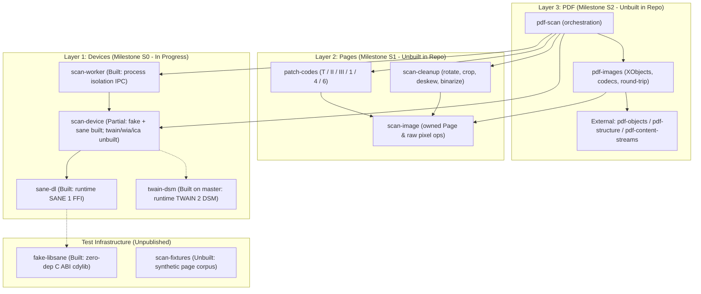

# Architectural, Gap, & Documentation Review: `pdf-scan`

**Reviewed date:** 2026-11-11  
**Reviewed revision:** `master` at `8de47ac` (post-S0 slice 5 `scan-device` SANE backend merge, PR #9)  
**Workspace footprint:** ~57.3k lines across 5 implemented crates (`sane-dl`, `fake-libsane`, `twain-dsm`, `scan-device`, `scan-worker`), CI scripts, and internal design/planning docs in [docs/pm/README.md](docs/pm/README.md).

---

## 1. Executive Assessment & "Pure Rust" Reality

`pdf-scan` exhibits **unusually rigorous systems engineering** for an early-stage (`0.1.0-alpha.0`) workspace. Rather than rushing end-to-end prototypes with `bindgen` wrappers and ad-hoc glue, the repository establishes strict crate boundaries, enforces them mechanically in CI, isolates crash-prone C/C++ vendor drivers behind both safe FFI state machines and an out-of-process IPC broker, and verifies those boundaries against custom protocol-validating test doubles.

> [!IMPORTANT]
> **Current Completeness vs. Goal:** Today, `pdf-scan` is a **scanner-acquisition foundation**, not yet a scan-to-PDF library. All **5 existing crates** belong to Milestone S0 (the **Devices** and **Tests** layers). **0 of the 5 Pages and PDF crates** (`scan-image`, `scan-cleanup`, `patch-codes`, `pdf-images`, `pdf-scan`) exist in this repository yet, though roughly 4,400 lines of their algorithms already live in a downstream application awaiting extraction in Milestones S1 and S2, and the PDF layer depends on sibling crates in the external `pdf-lint` workspace ([docs/pm/pdf-lint/README.md](docs/pm/pdf-lint/README.md)).

### What "Pure Rust" Means Here
Because OS scanner ecosystems require speaking to vendor-supplied binary drivers, "pure Rust" in `pdf-scan` means:
1. **Zero C/C++ build-time toolchains, `*-sys` crates, or link-time C/copyleft libraries** (verified on Linux via `readelf -d` in [justfile](justfile#L283-L303)).
2. **Runtime-only OS boundary loading** (`libloading` for `libsane.so.1` / `libsane.1.dylib` in `sane-dl`; Win32 `LoadLibraryExW` for `TWAINDSM.dll` in `twain-dsm`, with WIA COM and macOS ImageCaptureCore planned).
3. **Pure-Rust image processing, codecs, and PDF assembly** above the device layer (`zune-jpeg`, `jpeg-encoder`, `fax`, `png`, `tiff`, `hayro-ccitt`, `hayro-jbig2`, `hayro-jpeg2000`, plus pure-Rust `pdf-*` crates).



---

## 2. Design Strengths

### 2.1 Safe-by-Construction FFI & Protocol Enforcement (`sane-dl` & `twain-dsm`)
Both driver crates treat vendor C/C++ code as adversarial—assuming drivers can violate specs, return reserved integers, spawn background threads, or run nested GUI loops:

- **Zero FFI leakage in public APIs:** `sane-dl` uses integer newtypes ([`Status`](crates/sane-dl/src/lib.rs#L112-L120), [`FrameFormat`](crates/sane-dl/src/lib.rs#L194-L201)) rather than Rust `#[repr(C)] enum`s so out-of-range or `#if 0` SANE status codes can never trigger Rust undefined behavior. [public-api.jq](scripts/public-api.jq#L1-L65) inspects nightly rustdoc JSON in CI to forbid `unsafe fn`, raw pointers, `NonNull`, and foreign re-exports in the safe public API.
- **Process-wide SANE invariants:** [`Sane`](crates/sane-dl/src/library.rs#L211-L224) intentionally leaks the `libloading::Library` via `Box::leak` on `sane_exit` so lingering backend threads or `atexit` handlers never jump into unmapped executable pages, and [`ProcessSlot`](crates/sane-dl/src/process_slot.rs#L31-L34) claims a Linux abstract Unix socket (`sane-dl/slot/pidns/<dev>/<ino>/pid/<pid>`) so even *two distinct semver copies* of `sane-dl` linked into one process cannot initialize `libsane` simultaneously.
- **Lock-safe async cancellation:** [`CancelToken`](crates/sane-dl/src/library.rs#L180-L190) shares a `Mutex<bool>` (`alive`) with [`Handle::drop`](crates/sane-dl/src/library.rs#L580-L600) so cross-thread `sane_cancel` is guaranteed either to run before `sane_close` or become a no-op, never racing handle destruction.
- **Pre-load DLL verification in `twain-dsm`:** Before `LoadLibraryExW` maps a single page of `TWAINDSM.dll`, [`load_verified`](crates/twain-dsm/src/dsm.rs#L165-L215) opens the file handle, checks the PE `Machine` header ([pe.rs](crates/twain-dsm/src/pe.rs#L26-L40)), verifies an offline WinTrust Authenticode chain signed by `"TWAIN Working Group"` (`CERT_CHAIN_CACHE_ONLY_URL_RETRIEVAL`), loads by path, and compares the 128-bit `FILE_ID_INFO` (volume + file ID) of the mapped module against the verified file handle to defeat TOCTOU swaps and `SysWOW64` redirection mismatches.
- **Linear typestates + shadow rollback:** [`with_dsm`](crates/twain-dsm/src/lib.rs#L94-L108) / [`Dsm::run`](crates/twain-dsm/src/thread.rs#L99-L148) binds a `!Send + !Sync` [`Twain<'a>`](crates/twain-dsm/src/thread.rs#L39-L55) token with an invariant HRTB lifetime (`for<'a>`) and models TWAIN states 2–7 as move-only typestates ([`Loaded`](crates/twain-dsm/src/states.rs#L40-L43) → [`Opened`](crates/twain-dsm/src/states.rs#L50-L53) → [`Source`](crates/twain-dsm/src/states.rs#L61-L65) → [`Enabled`](crates/twain-dsm/src/enabled.rs#L32-L38) → [`Ready`](crates/twain-dsm/src/enabled.rs#L48-L51)) returning `#[must_use]` [`Refused<S>`](crates/twain-dsm/src/states.rs#L74-L82) on rejected transitions. Crucially, `Twain` tracks actual protocol state in a `Cell<Actual>` shadow slot, so even `std::mem::forget` or a panic unwind steps down cleanly from state 7 to state 2.
- **Modal-loop-proof callback delivery:** Because Windows TWAIN drivers spin private Win32 modal message loops that swallow thread queue messages (`PostThreadMessageW`), [`window.rs`](crates/twain-dsm/src/window.rs#L35-L75) pairs `DAT_CALLBACK2` with a lock-free 64-slot atomic ring buffer tagged by an `enable` generation counter plus an idempotent `PostMessageW(hwnd, WM_APP, ...)` wakeup on a message-only `HWND_MESSAGE` window.

### 2.2 Explicit Seam Design & Hardware Honesty (`scan-device`)
Writing [scan-device-seam.md](docs/pm/crates/scan-device-seam.md) before freezing [`Backend`](crates/scan-device/src/device.rs#L17-L49) and [`Device`](crates/scan-device/src/device.rs#L57-L119) paid off in subtle domain details that ad-hoc scanner wrappers usually get wrong:
- **Sheet-granular cancellation & bounded backpressure:** [`Device::scan`](crates/scan-device/src/device.rs#L97-L115) checks cancellation via `in_progress::Progress` *only between sheets* ([batch.rs](crates/scan-device/src/sane/batch.rs#L85-L90)), never stranding a duplex sheet's back side, and sends [`Event`](crates/scan-device/src/page.rs#L118-L133) values over a `SyncSender` *between pages*, never stalling hardware mid-pass.
- **Asymmetric SANE retry safety:** In [`batch::scan`](crates/scan-device/src/sane/batch.rs#L100-L120), if `sane_start` fails with `INVAL` on `Side::Front`, settings are restored once via [`settings::restore`](crates/scan-device/src/sane/settings.rs#L80-L127); on `Side::Back`, retry is deliberately suppressed because cancelling SANE mid-sheet drops buffered backs on single-pass duplex scanners and would swap front/back parity on subsequent sheets.
- **Safe USB renumbering fallback:** [`reopen`](crates/scan-device/src/sane/mod.rs#L194-L234) recovers when Linux `libusb:<bus>:<dev>` numbers change across unplug/replug *only* when backend prefix, maker, and model all match, and explicitly rejects SANE `dll` alias hazards (`fakeusb*`, leading `:`).
- **Checked pixel layout invariants:** [`RawImage::new`](crates/scan-device/src/image.rs#L150-L185) validates `u64` byte counts, `isize::MAX` allocation bounds, and cleared `Bw1` row-padding bits; [`pixels::expand`](crates/scan-device/src/sane/pixels.rs#L110-L125) checks 8× expanded size against `frame_cap` *before* allocating.

### 2.3 Defense-in-Depth Process Broker (`scan-worker`)
[`scan-worker`](crates/scan-worker/src/lib.rs#L1-L130) contains `#![forbid(unsafe_code)]` and treats its own child process as untrusted:
- **Client-side wire & state-machine verification:** [`client/read.rs`](crates/scan-worker/src/client/read.rs#L115-L215) caps line lengths and frame allocations before allocating buffers, validates `f32::is_finite()` on wire floats, and verifies `Applied` → `Sheet` → `Page` ordering and monotonic sheet numbers in [`client/worker.rs`](crates/scan-worker/src/client/worker.rs#L130-L215).
- **Consumer-fair watchdog & grandchild-pipe immunity:** Silence timeouts count *only* while blocked waiting on the worker—never while the caller's `SyncSender<Event>` is full—and poll `Child::try_wait` every 50 ms so a crashed driver whose spawned helper grandchild inherited stdout cannot hang the parent forever. All pages already sent before a mid-batch crash or hang remain intact.

### 2.4 Automated Architectural Gates & High-Fidelity Test Doubles
- [justfile](justfile#L223-L322) (`just gates`) mechanically enforces layer boundaries (`cargo tree` bans codecs, PDF, OCR, and GUI crates from device crates), zero dependencies in `fake-libsane`, no link-time `libsane`, and clean rustdoc across both individual crates and `--all-features`.
- [`fake-libsane`](crates/fake-libsane/src/lib.rs#L1-L95) (a zero-dependency C ABI `cdylib` that enforces SANE's call-order state machine), [`scan_device::fake`](crates/scan-device/src/fake/mod.rs) (fault injection for `Crash`, `Hang`, `AwaitCancel`, paper jams), and CI jobs exercising real `libsane` (`test` + `pnm`) and real Windows `TWAINDSM.dll` (both `x86_64` and `i686` 32-bit!) provide exceptional test leverage without physical hardware.

---

## 3. Design Weaknesses, Tensions, & Subtle Risks

### 3.1 Unconditional `sane-dl` Dependency in `scan-worker` (Cross-Platform Leakage)
In [crates/scan-worker/Cargo.toml](crates/scan-worker/Cargo.toml#L16-L18), `sane-dl` is an **unconditional, non-optional** dependency even when `scan-worker`'s `sane` feature is disabled and even on Windows targets:
```toml
[dependencies]
in-progress = { workspace = true }
sane-dl = { workspace = true }
scan-device = { workspace = true }
```
It is used solely in [client/spawn.rs](crates/scan-worker/src/client/spawn.rs#L10-L72) for `sane_dl::backend_of` and `sane_dl::ConfigDir::write` (~40 lines of pure string splitting and temp-dir `.conf` writing).
- **Impact:** A Windows-only TWAIN/WIA build of `scan-worker` needlessly compiles `sane-dl` and `libloading`, and `scan-worker` is semver-coupled to `sane-dl` even for callers who never enable `sane`.

### 3.2 Missing Polymorphism Between `scan-device` and `scan-worker`
[`Client`](crates/scan-worker/src/client.rs) and [`RemoteDevice`](crates/scan-worker/src/client.rs) deliberately mirror [`Backend`](crates/scan-device/src/device.rs#L17-L49) and [`Device`](crates/scan-device/src/device.rs#L57-L119) method-for-method, returning [`scan_worker::Error`](crates/scan-worker/src/error.rs) instead of [`ScanError`](crates/scan-device/src/error.rs), and **do not implement `Backend` or `Device`**.
- **Impact:** Any higher-level orchestrator (including the planned `pdf-scan` crate in Milestone S2 or CLI/GUI apps that want an `--in-process` debug flag alongside worker-isolated production scanning) cannot accept `Box<dyn Device>` uniformly without writing a third wrapper trait or mapping `scan_worker::Error` into `ScanError::Driver` (losing structured `Crashed` / `TimedOut` variants).

### 3.3 Whole-Page Uncompressed Memory Buffering & 32-bit Worker Risk
Every scanned page currently travels end-to-end as an owned `Vec<u8>` inside [`RawImage`](crates/scan-device/src/image.rs#L132-L140):
1. `sane-dl` assembles the full page into `Image::data: Vec<u8>`.
2. `scan-device` transforms or expands it into `RawImage` (`Vec<u8>`).
3. `scan-worker` writes the uncompressed bytes over stdout while holding the page, and the parent allocates `vec![0; length]` in [`read_bytes`](crates/scan-worker/src/client/read.rs#L155-L165).

| Page Spec (US Letter 8.5" × 11") | Uncompressed `RawImage` Size | Peak Across Worker + Client |
| :--- | ---: | ---: |
| 300 dpi `Rgb8` | ~25.2 MB | ~50–75 MB |
| 600 dpi `Rgb8` | ~101.0 MB | ~202–303 MB |
| 1200 dpi `Rgb8` | ~404.0 MB | ~808 MB – 1.2 GB |
| 1200 dpi `Rgb16` (A3 / Ledger) | ~1,616.0 MB | Exceeds 32-bit `i686` 2 GiB VA! |

- **Impact:** `scan-worker`'s 32-bit Windows worker helper (`i686-pc-windows-msvc`, a primary motivation for out-of-process TWAIN!) only has a 2 GiB user virtual address space unless `LARGEADDRESSAWARE` is set, and even `Limits::default().frame_bytes` (`512 MiB` in `sane-dl`, `512 MiB` `max_page_bytes` in `scan-worker`) blocks legitimate 1200 dpi color scans unless raised, while raising it risks OOM in 32-bit workers until compressed transfers ([`Pixels::Encoded`](crates/scan-device/src/page.rs#L53-L63)) or strip streaming are implemented.

### 3.4 Exact-Match English SANE Option Tables & Inherited Locale Hazard
In [`scan-device/src/sane/options.rs`](crates/scan-device/src/sane/options.rs#L18-L20), source and mode option strings are matched byte-for-byte against English literals (`"Flatbed"`, `"ADF Front"`, `"Color"`, `"Lineart"`, etc.), explicitly ignoring localized strings.
- **Subtle interaction with `scan-worker`:** Several SANE backends call `gettext` (`dgettext("sane-backends", ...)`) if the process calls `setlocale` (which GTK/Qt/GUI toolkits do in-process, or which env vars like `LC_ALL` / `LANGUAGE` trigger in helpers). [`client/spawn.rs`](crates/scan-worker/src/client/spawn.rs#L24-L45) inherits the parent environment **without** setting `LC_ALL=C` / `LANG=C` on the spawned worker! In a non-English desktop session or an in-process GUI app, localized SANE string constraints can cause [`caps::read`](crates/scan-device/src/sane/caps.rs#L25-L34) to drop sources/modes and fail with [`ScanError::Unsupported`](crates/scan-device/src/error.rs).
- **Vendor coverage gaps:** Real-world SANE backends emit strings not yet in [`options.rs`](crates/scan-device/src/sane/options.rs#L69-L98), such as `"ADF Back"`, `"Auto"` / `"Automatic"`, `"Transparency Adapter"` / `"TPU"`, `"24bit Color[Fast]"` (brother4/brscan4), `"Black & White"`, or `"Halftone"`-only binary modes.
- **Capability-probing hardware side effect:** [`read_sources`](crates/scan-device/src/sane/caps.rs#L62-L120) actively mutates the live SANE `source` option across `Flatbed` and `Feeder` and restores it afterward. That is the right way to discover source-dependent SANE descriptors, *but* calling `Device::caps()` after `sane_options` or vendor UI configuration can reset source-coupled backend options, and on some mechanical combo scanners switching `source` actuates physical carriages/relays.

### 3.5 Process-Lifecycle & Concurrency Rough Edges in `scan-worker` & Drivers
1. **Cold-start cost per `list()` and `open()`:** Spawning a fresh worker for every `list()` and `open()` means Windows `TWAINDSM.dll` runs `MSG_OPENDSM` from scratch each time—and `TWAINDSM` enumerates by calling `LoadLibrary` on *every* `.ds` driver installed in `C:\Windows\twain_32`. With bloated vendor driver suites, cold `list()` + `open()` doubles that cost without a warm spare worker (`FEAT-15`).
2. **No cancel/kill handle while `&mut RemoteDevice` is borrowed:** [`RemoteDevice::settings_window`](crates/scan-worker/src/client.rs) is untimed (`FEAT-17`) and borrows `&mut self`. If a vendor driver's Win32 modal dialog hangs, the application's UI cancel button on another thread has no `AbortHandle` to terminate the worker process.
3. **Unchecked `Sane::load` environment preconditions & Linux-only `ProcessSlot`:** [`Sane::load`](crates/sane-dl/src/library.rs#L225-L260) is a safe `fn`, yet relies on callers not concurrently mutating `LD_LIBRARY_PATH` or `current_dir` when `LD_LIBRARY_PATH` contains relative/empty segments (`Q-7`, `UP-14`), and [`ProcessSlot`](crates/sane-dl/src/process_slot.rs#L17-L28) is a no-op on macOS/BSD (`BUG-8`), where two semver copies of `sane-dl` in one process can still race `sane_init`.
4. **TWAIN global CWD mutation & 64-slot callback ring:** `TWAINDSM.dll`'s `MSG_OPENDSM` temporarily mutates process-wide `SetCurrentDirectory` on Windows ([states.rs](crates/twain-dsm/src/states.rs#L100-L103)), which is hazardous if `twain-dsm` is ever used in-process alongside multi-threaded file I/O; and [`RING = 64`](crates/twain-dsm/src/window.rs#L37) silently overwrites the oldest callback message if a chatty driver fires >64 callbacks before the loop drains them ([window.rs](crates/twain-dsm/src/window.rs#L120-L132)).
5. **Unix `SIGPIPE` & Windows orphan grandchildren:** Library consumers in non-Rust hosts or CLIs that reset `SIGPIPE` to `SIG_DFL` can be terminated when writing `Bye` to a crashed worker (`FEAT-16`), and Windows workers are not yet placed in a `JOB_OBJECT_LIMIT_KILL_ON_JOB_CLOSE` Job Object (`FEAT-14`).

### 3.6 Packaging & Forward-Compatibility Traps Before `0.1.0`
- **`cargo package` self-dev-dependency breakage (`Q-5`):** Both [crates/scan-device/Cargo.toml](crates/scan-device/Cargo.toml#L25-L26) and [crates/scan-worker/Cargo.toml](crates/scan-worker/Cargo.toml#L24-L25) enable `features = ["fake"]` via a path-only self `dev-dependency` (`scan-device = { path = ".", features = ["fake"] }`). `cargo package` strips path-only self dev-dependencies lacking a published `version`, causing `cargo package` verification tests and doctests to fail unless integration tests declare `required-features = ["fake"]` or doctests are `#[cfg(feature = "fake")]`-gated.
- **Serde evolution vs. `#[non_exhaustive]` (`Q-8`):** Persisted structs like [`DeviceInfo`](crates/scan-device/src/device.rs) and [`Settings`](crates/scan-device/src/caps.rs) combine `#[non_exhaustive]` with plain `#[derive(Deserialize)]`. Adding a field in a minor release will fail to deserialize JSON saved by older versions unless new fields carry `#[serde(default)]` (and unknown enum variants in persisted configs have a documented migration story).

---

## 4. Gaps Relative to a Complete Pure-Rust Scan-to-PDF Ecosystem

### 4.1 Crate & Platform Matrix

| Layer | Component | Target Status | Current Status on `master` | Key Remaining Gap |
| :--- | :--- | :--- | :--- | :--- |
| **Devices (S0)** | `sane-dl` | S0 Slice 1 | **Complete** | Non-Linux `ProcessSlot` (`BUG-8`); `Sane::load` env check |
| **Devices (S0)** | `twain-dsm` | S0 Slice 8 | **Complete** | Missing `README.md`, `CHANGELOG.md`, `docs.rs` target metadata |
| **Devices (S0)** | `scan-device` (`fake`, `sane`) | S0 Slices 2, 5 | **Complete** | Real hardware matrix (`TEST-1`); `sane-airscan` validation |
| **Devices (S0)** | `scan-device` (`twain`, `wia`, `ica`) | S0 Slices 6, 7, 9 | **Unbuilt (0/3)** | **No Windows (`twain`/`wia`) or macOS (`ica`) `scan-device` backend yet** |
| **Devices (S0)** | `scan-worker` | S0 Slice 4 | **Complete** | Warm spare (`FEAT-15`), Windows Job Object (`FEAT-14`), settings abort (`FEAT-17`) |
| **Pages (S1)** | `scan-image` | S1 | **Unbuilt in repo** | Owned `Page` pixel buffer & conversions (~1.4k LoC in downstream app) |
| **Pages (S1)** | `scan-cleanup` | S1 | **Unbuilt in repo** | Rotate, deskew, auto-crop, Sauvola/Otsu threshold, blank-page detection |
| **Pages (S1)** | `patch-codes` | S1 | **Unbuilt in repo** | Patch T / II / III / 1 / 4 / 6 barcode separator detection |
| **PDF (S2)** | `pdf-images` | S2 | **Unbuilt in repo** | Image XObject writing (CCITT G4, JPEG, Flate) & lossless/decoded extraction |
| **PDF (S2)** | `pdf-scan` | S2 | **Unbuilt in repo** | End-to-end scan → cleanup → split → PDF pipeline & page streaming |
| **Tests** | `scan-fixtures` | S1 | **Unbuilt in repo** | Deterministic synthetic scanned pages for cleanup/patch-code/PDF tests |

### 4.2 Functional & Ecosystem Gaps for Real-World Document Scanning
Even accounting for S1 and S2 as planned in [docs/pm/plan.md](docs/pm/plan.md), several ecosystem-level gaps stand out for users expecting a complete pure-Rust scan-to-PDF stack:

1. **Network Driverless Scanning (eSCL / AirScan & WSD) Without `libsane`:**
   - Modern office/home scanners speak HTTP/XML **eSCL (Apple AirScan / Mopria)** over mDNS. Today, Linux users rely on C `sane-airscan` behind `libsane.so.1`, while Windows/macOS rely on OS WIA/ICA bridges. A native pure-Rust eSCL backend in `scan-device` (optional feature) would deliver *100% pure-Rust* driverless scanning across Linux, macOS, Windows, and containers with zero C libraries even at runtime.
2. **Hardware Compressed Transfer (`Encoding::Jpeg` / `CcittG4`) End-to-End Pass-Through:**
   - [`Pixels::Encoded`](crates/scan-device/src/page.rs#L53-L63) is thoughtfully reserved in the `scan-device` seam, and `scan-worker` already frames `EncodedPage` on the wire, but no backend emits it yet and S1/S2 must ensure hardware-JPEG / G4 pages can pass straight into `pdf-images` PDF XObjects without forced decode → re-encode generation loss when cleanup isn't mutating pixels.
3. **Color Management (ICC Profiles & sRGB Tagging) & PDF/A Archival Compliance:**
   - Document scanning to PDF frequently targets **PDF/A-1b, PDF/A-2b, or PDF/A-3b** for legal/enterprise archiving. `pdf-images` plans `/DeviceGray` and `/DeviceRGB` XObjects, whereas PDF/A requires output intents or ICC-based color spaces (`/ICCBased` / calibrated sRGB), XMP metadata packets, and file ID trailers—plus TWAIN/WIA/ICA drivers often attach scanner ICC profiles that currently have nowhere to travel on [`RawPage`](crates/scan-device/src/page.rs#L65-L90).
4. **OCR / Searchable PDF Text Layer Seam:**
   - Explicitly out of scope for `pdf-scan` (`just gates` bans OCR in device crates), which is the right scope boundary—*however*, `pdf-images` / `pdf-scan` in S2 will be far more valuable to the Rust ecosystem if its page-builder API lets callers attach an invisible text/glyph overlay stream (from pure-Rust `ocrs`, external Tesseract, or cloud OCR) onto each scanned page while writing the PDF, rather than forcing a full PDF rewrite pass afterward.
5. **External Dependency Readiness & MSRV Conflict (`pdf-lint` & `hayro-*`):**
   - S2 depends on six sibling crates in `pdf-lint` (`pdf-objects`, `pdf-structure`, `pdf-content-streams`, `pdf-filters`, `pdf-color`, `pdf-semantics`), several of which are `0.1.0-alpha.0` or unpublished, with a known version mismatch on `hayro-ccitt` (`0.3` vs `0.5`, `PL-3`).
   - Workspace `rust-version = "1.89"` ([Cargo.toml](Cargo.toml#L9)) conflicts with planned S2 decoders `hayro-ccitt` / `hayro-jbig2` / `hayro-jpeg2000` requiring Rust `1.92` (`Q-1`), and those three complex binary decoders are single-maintainer crates not yet on OSS-Fuzz (`TEST-4`). Also `fax` `0.3.0` panics on widths > 32,767 px until `0.3.1` (`BUG-1`).
6. **Hardware Signal Nuances:**
   - Multi-feed / ultrasonic double-feed detection (critical on production Fujitsu/Ricoh/Canon document scanners—currently SANE's `JAMMED` covers some, while TWAIN `CAP_DOUBLEFEEDDETECTION` needs explicit error/warning modeling), lamp warmup progress state, and flatbed preview vs. final crop workflow.

---

## 5. Documentation Coverage & Quality

### 5.1 Quantitative Rustdoc & Crate Metadata Audit

`just doc` builds cleanly with `RUSTDOCFLAGS="-D warnings"`, and internal documentation density is extraordinarily high. However, running `RUSTFLAGS="-W missing_docs" cargo check --locked --workspace --lib --all-features` exposes sharp differences across crates:

| Crate | `#![warn(missing_docs)]` | `missing_docs` Count | `README.md` | `CHANGELOG.md` | `[package.metadata.docs.rs]` |
| :--- | :---: | ---: | :---: | :---: | :---: |
| `sane-dl` | **No** ([lib.rs](crates/sane-dl/src/lib.rs#L1-L95)) | **0** (even `ffi`!) | Yes | Yes | Missing (`doc_cfg`) |
| `scan-device` | **Yes** ([lib.rs](crates/scan-device/src/lib.rs#L117)) | **0** | Yes | Yes | Missing (`all-features`, `doc_cfg`) |
| `scan-worker` | **Yes** ([lib.rs](crates/scan-worker/src/lib.rs#L126)) | **0** | Yes | Yes | Missing (`all-features`, `doc_cfg`) |
| `twain-dsm` | **No** ([lib.rs](crates/twain-dsm/src/lib.rs#L1-L75)) | **1,436** *(119 outside `ffi`!)* | **Missing** | **Missing** | **CRITICAL: Missing Windows target!** |
| `fake-libsane` | No *(unpublished)* | 0 | No *(N/A)* | No *(N/A)* | N/A (`publish = false`) |

> [!WARNING]
> **Critical `docs.rs` Trap in `twain-dsm`:** In [crates/twain-dsm/src/lib.rs](crates/twain-dsm/src/lib.rs#L1-L75), both the main crate-level rustdoc (`#![cfg_attr(windows, doc = ...)]`) and almost all public modules (`dsm`, `states`, `enabled`, `thread`, `verify`, `error`, `with_dsm`) are gated behind `#[cfg(windows)]`, while [crates/twain-dsm/Cargo.toml](crates/twain-dsm/Cargo.toml#L1-L26) has **no `[package.metadata.docs.rs]` section**. Because `docs.rs` builds on `x86_64-unknown-linux-gnu` by default, publishing `twain-dsm` as-is would render an almost blank page missing `Dsm`, `with_dsm`, typestates, and the crate overview!
>
> In addition, **119 of `twain-dsm`'s 1,436 `missing_docs` warnings are in safe high-level modules**—not `ffi`—specifically `43` in [codes.rs](crates/twain-dsm/src/codes.rs) (`ReturnCode`/`ConditionCode` associated constants and `Triplet` fields), `75` in [container.rs](crates/twain-dsm/src/container.rs) (`ItemType`, `Item`, `ContainerError` variants, `Enumeration` fields), and `1` in [ext_info.rs](crates/twain-dsm/src/ext_info.rs).

### 5.2 Missing `doc_cfg` Badges & Root Onboarding Gaps
- **No portability/feature badges in rustdoc:** None of the crates enables `#![cfg_attr(docsrs, feature(doc_cfg))]` (or nightly `doc_auto_cfg`), nor sets `[package.metadata.docs.rs] all-features = true`. Consequently, feature-gated APIs (`scan_device::fake`, `scan_device::sane`, `serde` impls) and OS-specific methods ([`Handle::select_fd`](crates/sane-dl/src/library.rs) on Unix) either vanish from default docs or appear without `"Available on crate feature sane only"` callouts.
- **Sparse root [README.md](README.md):** At 38 lines, the workspace README clearly states the three layers and crate status, *but* lacks:
  - A 15-line runnable quickstart example (e.g., scanning a page with `scan_device::fake` or `scan_worker`).
  - System prerequisites and contributor workflow (`just ci`, `libsane` test packages, MSRV `1.89`).
  - Clarity on what "pure Rust" means regarding runtime OS driver loading (`libsane.so.1` / `TWAINDSM.dll`).

### 5.3 Internal PM Documentation Drift (`docs/pm/`)
The `docs/pm/` tree is remarkably well-organized—especially [scan-device-seam.md](docs/pm/crates/scan-device-seam.md), [decisions.md](docs/pm/decisions.md), and the prior-art survey in [docs/pm/research/prior-art/README.md](docs/pm/research/prior-art/README.md)—but status files have drifted behind git history and contradict each other:
- [docs/pm/plan.md](docs/pm/plan.md#L40) lists `twain-dsm` (slice 8) as **"unbuilt"**, directly contradicting root [README.md](README.md#L19) (`twain-dsm` built and merged on `master`).
- [docs/pm/status.md](docs/pm/status.md#L10-L24) and [docs/pm/crates/scan-device.md](docs/pm/crates/scan-device.md#L5) still describe slice 4 (`scan-worker`) as unmerged on branch `s0-4-scan-worker` and slice 5 (`scan-device` SANE backend) as unstarted, even though both slice 4 (`d22a2f4`) and slice 5 (`8de47ac`) are merged on `master`.

### 5.4 Prose Style & Readability Critique
There is a striking duality in the repository's prose:
- **Substance (A+):** Every subtle edge case, protocol invariant, panic/drop behavior, wire frame format, and error postcondition is explicitly specified and backed by tests (including `compile_fail` doctests in `twain-dsm` and unit tests in `sane-dl` that verify README license links and CHANGELOG version headers). An independent implementer could write a compatible `scan-worker` from [crates/scan-worker/src/lib.rs](crates/scan-worker/src/lib.rs#L1-L120) alone.
- **Syntax & Skimmability (C+ for external readers):** Across rustdoc, READMEs, and code comments, the codebase uses an idiosyncratic, compressed, literary style characterized by nominative absolutes, elided verbs, nested semicolons, and inverted clauses. Examples from public rustdoc and comments:
  - *"A name given since to another device of the same maker and model opens that device unremarked."* ([scan-device/src/lib.rs](crates/scan-device/src/lib.rs#L88-L90))
  - *"What a device can do, per source, and what a batch asks it to: [`Caps`] and [`Settings`], and [`Applied`] for what the device took and what it changed of what was asked."* ([scan-device/src/caps.rs](crates/scan-device/src/caps.rs#L1-L3))
  - *"the higher of two as near"* / *"a feeder's both sides as a feeder with duplex, a feeder's one side with duplex where an option apart from the source gives it; none for a value no row names."* ([scan-device/src/sane/caps.rs](crates/scan-device/src/sane/caps.rs#L122-L124))

> [!TIP]
> **Why this matters for adoption:** While internally consistent and unambiguous once parsed carefully, appositive-heavy sentences without main verbs force readers (especially non-native English speakers scanning docs.rs) to re-read sentences two or three times. Keeping the exactness of the contracts while shifting public rustdoc lead sentences to **active, subject–verb technical prose + Markdown tables/bullet lists** will dramatically improve approachability without losing rigor.
>
> *Example rewrite:*  
> - **Current:** *"A name given since to another device of the same maker and model opens that device unremarked."*  
> - **Clearer:** *"If the OS reassigns a USB address to a different physical unit of the exact same maker and model, `open` cannot distinguish them and opens the new unit without warning."*

---

## 6. Prioritized Recommendations

### Immediate / Pre-Publish Quick Wins (Milestone S0 Polish)
1. **Fix `twain-dsm` `docs.rs` & missing docs:** Add `[package.metadata.docs.rs] default-target = "x86_64-pc-windows-msvc"` to [crates/twain-dsm/Cargo.toml](crates/twain-dsm/Cargo.toml), document the 119 safe items in `codes.rs` / `container.rs` / `ext_info.rs`, enable `#![warn(missing_docs)]` (with `#[allow(missing_docs)]` scoped only to `pub mod ffi` if desired), and add `crates/twain-dsm/{README.md,CHANGELOG.md}`.
2. **Guard `sane-dl` docs & enable `doc_cfg` workspace-wide:** Add `#![warn(missing_docs)]` to [crates/sane-dl/src/lib.rs](crates/sane-dl/src/lib.rs) so its current 0-warning state cannot regress, and add `[package.metadata.docs.rs] all-features = true` + `doc_cfg` across publishable crates.
3. **Decouple `scan-worker` from unconditional `sane-dl`:** Gate `sane-dl` behind `scan-worker`'s `sane` feature in [crates/scan-worker/Cargo.toml](crates/scan-worker/Cargo.toml#L17) (or inline the trivial `backend_of` / `.conf` directory writer in `client/spawn.rs`) and force `LC_ALL=C` (or `LC_MESSAGES=C`) on SANE worker subprocesses unless explicitly overridden so localized SANE backends don't break [`options.rs`](crates/scan-device/src/sane/options.rs).
4. **Fix packaging & serde forward-compatibility (`Q-5`, `Q-8`):** Replace self-`dev-dependencies` feature activation with `required-features = ["fake"]` on integration tests + `cargo package --workspace --no-verify` check in `just gates`, and add `#[serde(default)]` discipline to `#[non_exhaustive]` serializable structs.
5. **Reconcile `docs/pm/{plan,status}.md` and expand root `README.md`:** Sync slice 4/5/8 status and add a minimal quickstart example + architecture overview to [README.md](README.md).

### Medium-Term Architectural Priorities (Before Freezing S0 / Building S1–S2)
1. **Provide a unified execution trait or adapter for `Device` + `RemoteDevice`:** Either provide an `IntoScanError` adapter wrapping `RemoteDevice` as a `scan_device::Device` (mapping IPC crashes/timeouts to a dedicated `ScanError` variant or wrapper) or define a shared trait so `pdf-scan` (S2) can drive both in-process and worker-isolated scanners seamlessly.
2. **Add an async/cross-thread `CancelHandle` / `KillHandle` to `RemoteDevice` (`FEAT-17`) and Windows Job Object (`FEAT-14`):** Essential before shipping interactive GUI `settings_window` support on Windows TWAIN drivers.
3. **Wire compressed transfer pass-through (`Pixels::Encoded`) & `LARGEADDRESSAWARE` for 32-bit workers:** Crucial for 600–1200 dpi color duplex batches over IPC and for lossless JPEG/G4 pass-through into `pdf-images`.
4. **Resolve MSRV (`1.89` vs `1.92`) and fuzz `hayro-*` / `fax` before S2:** Bump workspace MSRV intentionally when landing `pdf-images`, require `fax >= 0.3.1`, align `pdf-lint` crate versions, and add `cargo-fuzz` targets over untrusted scanner/PDF image streams.
5. **Plan pure-Rust eSCL (AirScan), ICC/PDF-A metadata hooks, and OCR overlay hooks:** Designing optional ICC profile metadata onto page types in S1 and a page content-stream overlay hook in `pdf-images` / `pdf-scan` in S2 will prevent breaking API churn later while positioning `pdf-scan` as a complete document-scanning foundation.
